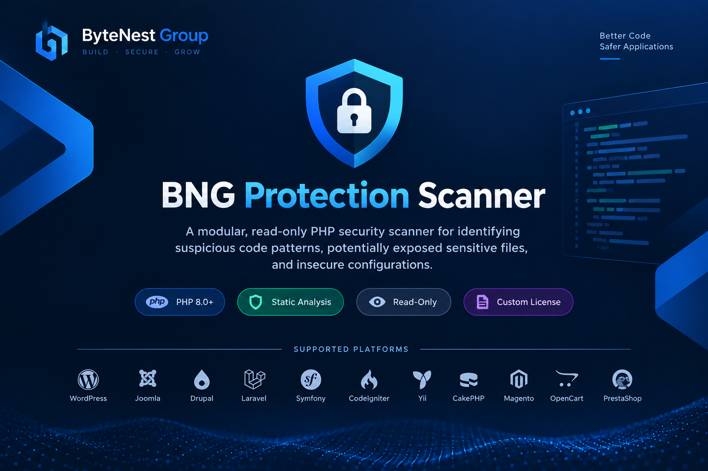

# 🛡️ BNG Protection Scanner

<p align="center">
  
</p>

<p align="center">
  <strong>ByteNest Group</strong>
  <br>
  <em>PHP Security Analysis • Static Scanning • Read-Only Inspection</em>
</p>

<p align="center">
  
  
  
  
</p>

<p align="center">
  A modular, read-only PHP security scanner for identifying suspicious code patterns,
  potentially exposed sensitive files, and insecure configurations.
</p>

<p align="center">
  <a href="#-overview">Overview</a> •
  <a href="#-features">Features</a> •
  <a href="#-supported-platforms">Platforms</a> •
  <a href="#-installation-and-configuration">Installation</a> •
  <a href="#-limitations">Limitations</a> •
  <a href="#-license">License</a>
</p>

---

## 📌 Overview

**BNG Protection Scanner** is a lightweight, modular static security scanner for PHP websites and applications, developed by **Abolfazl Shoja — ByteNest Group**.

It examines source code and configuration files for suspicious patterns, potentially exposed sensitive files, insecure settings, and other security concerns.

The scanner is designed to inspect files **without executing the PHP code being analyzed or modifying the scanned files**.

> [!IMPORTANT]
> This tool provides heuristic security findings, not definitive malware or vulnerability verdicts. A clean scan does not guarantee that an application is secure.

## ✨ Features

- 🛡️ **Read-only scanning** — designed to inspect files without modifying them.
- 🧩 **Modular checks** — organized security checks and scanner components.
- 🔎 **Suspicious-pattern detection** — identifies PHP code patterns that may warrant investigation.
- 🔐 **Sensitive-file checks** — looks for potentially exposed files and insecure configurations.
- 📄 **JSON findings** — produces structured, machine-readable findings.
- ⚙️ **Resource limits** — limits scan workload through documented caps.
- 🧰 **Platform-oriented analysis** — combines generic PHP scanning with platform-specific checks.

## 🧱 Supported Platforms

The project includes or is designed to support checks for the following systems:

| CMS | PHP Framework | E-commerce System |
|---|---|---|
| WordPress | Laravel | Magento |
| Joomla | Symfony | OpenCart |
| Drupal | CodeIgniter | PrestaShop |
| — | Yii | WooCommerce |
| — | CakePHP | — |

Coverage varies by system, rule set, and version. Listing a system does not imply complete vulnerability coverage.

## 📋 Requirements

- **PHP 8.0 or later** for the core scanner.
- **PHP 8.1 or later** for the web endpoint.
- PHP extensions: `json`, `pcre`, `hash`, and `spl`.
- Apache or LiteSpeed rewrite support if required by the supplied `.htaccess` rules.

Verify your PHP version, enabled extensions, and web-server configuration before deployment.

## 📁 Project Structure

```text
BNG-Protection-Scanner/
├── centerpoint/   # Web endpoint components
├── scanner/       # Scanner implementation and checks
├── keys/          # Local secret-key configuration
├── htaccess       # Supplied web-server access rules
├── LICENSE        # Custom project license
└── README.md      # Project documentation
```

The public repository intentionally excludes local secret files. Never commit or publish the real activation key.

**🔐 Important - Keep the Activation Key Outside `public_html`.**

- Store `scanner-secret-key.php` outside the `public_html` directory.
- Replace the placeholder secret with a securely generated secret before deployment.
- Configure the scanner to load the secret from its secure server-side location.
- Never upload the real activation key to GitHub or expose it through browser-accessible files.
- Restrict filesystem permissions so only the required server-side process and authorized administrators can access the secret.

## 🚀 Installation and Configuration

1. Place the project in the intended application directory.
2. Review the source files and configuration before use.
3. Configure the scanner secret key securely.
4. Ensure sensitive configuration files cannot be downloaded over the web.
5. If enabling the web endpoint, require HTTPS and authenticated requests.
6. Restrict endpoint access to authorized users and systems.
7. Verify the effective web-server configuration before deployment.

Refer to the source files and configuration for the exact setup requirements of this version.

### 🔒 Web Endpoint Security

When the web endpoint is enabled:

- Use HTTPS.
- Use authenticated `POST` requests with the configured Bearer token.
- Never expose the secret key in browser-side code or public files.
- Restrict access at both the application and web-server levels.
- Review request handling, logging, and server permissions before production use.

**Do not assume `.htaccess` rules are enforced** unless you have verified that your web server supports and applies them.

## ⚙️ Default Scan Limits

Documented default limits include:

| Limit | Default |
|---|---:|
| Files per scan | 5,000 |
| Maximum file size | 2 MB |
| Scan time limit | 25 seconds |
| Findings per report | 500 |

A scan may be incomplete when a limit is reached. Review the report for truncation indicators before drawing conclusions.

## 🧪 Understanding Findings

Findings identify suspicious patterns or settings that may require further investigation. They do not automatically prove that a file is malicious or that an application is vulnerable.

Pattern-based analysis can produce:

- **False positives** — legitimate code flagged for review.
- **False negatives** — malicious or insecure code that is not detected.

Validate findings in context before taking corrective action.

## ⚠️ Limitations

BNG Protection Scanner is a static security analysis aid. It is **not a complete anti-malware solution** and does not guarantee that a website or application is secure.

It does not replace:

- Dedicated malware scanning.
- Comprehensive static analysis.
- Dependency and supply-chain auditing.
- Manual security reviews.
- Incident response and forensic investigation.

A clean scan does not prove that an application is free of vulnerabilities or malicious code.

### Testing Scope

Reported project testing includes automated tests in a PHP 8.4 and LiteSpeed environment.

Synthetic and structural test results do not establish detection accuracy against a comprehensive real-world malware corpus or prove production-scale performance. Additional real-world validation, load testing, and concurrency testing may be necessary before production deployment.

## 📜 License

This project is distributed under the custom license provided in [`LICENSE`](LICENSE).

**This is not an MIT-licensed project.**

Use is permitted subject to the license terms. Unauthorized sale is prohibited, and copyright and attribution notices must be preserved.

Review [`LICENSE`](LICENSE) for the complete terms.

## 👤 Author

**Abolfazl Shoja**  
**ByteNest Group**

Copyright © 2026 Abolfazl Shoja — ByteNest Group. All rights reserved.

---

<p align="center">
  <strong>ByteNest Group | Beyond Digital</strong>
  <br>
  <sub>Security analysis is a process—not a guarantee.</sub>
</p>